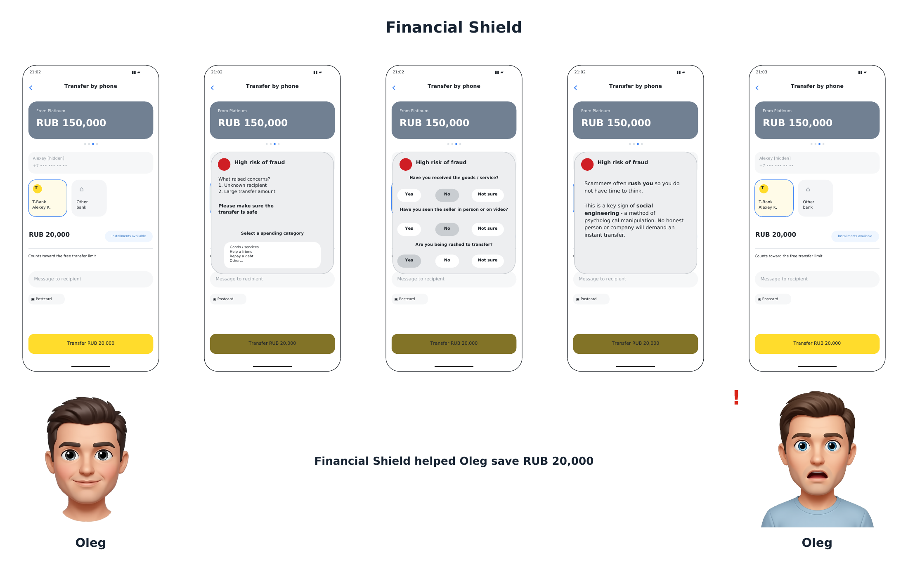

<h1>
  <a href="README.md"></a>
  <a href="README.ru.md"></a>
  Financial Shield
</h1>

[↩ Applied projects](https://github.com/levg00/levg00/blob/main/portfolio/applied.en.md)

A concept for a financial app feature that protects users from fraudulent and impulsive transactions. **I proposed warnings that adapt to transaction risk while leaving the final decision to the user.**

Case study completed as part of the selection process for an internship at **T-Bank**. Deliverables: a product concept, intervention logic, and **3 visual scenarios**.

**Product design · Requirements analysis · User scenarios · Risk assessment · Metrics**

### 🖼️ [Visual scenarios](#-user-scenarios) · 📄 [Full solution](materials/solution.en.pdf)

## 🎯 Task and solution

**Task:** help users avoid financial mistakes without creating unnecessary obstacles to routine transactions.

**Solution:** assess the transaction context and adjust the level of intervention — from no warning to clarifying questions and a temporary delay. The user retains the option to proceed.

| Risk | Feature behavior |
| :--- | :--- |
| 🟢 Low | Transaction proceeds without intervention |
| 🟡 Medium | Warning, explanation of the risk, and a confirmation question |
| 🔴 High | Warning, 2–3 questions, examples of fraud, and a temporary delay |

## ⚡ My contribution and skills applied

- **Requirements analysis:** accounted for effective, unobtrusive protection and keeping the user in control.
- **Product design:** proposed three levels of intervention and categories of data for risk assessment.
- **User scenarios:** worked through a fraudulent advance payment, an impulsive investment, and a routine purchase triggering a false positive.
- **Product analytics:** proposed metrics for protection effectiveness and its impact on the user experience.

## 🖼️ User scenarios

**Example: a suspicious advance payment for a PlayStation 5.** The warning explains the risk, questions help the user assess the situation, and a delay gives them time to reconsider.

[](materials/scenario-oleg.en.pdf)

*Concept illustration. The amount shown in the mockup belongs to a fictional scenario, not a measured implementation outcome. Click the image to open the PDF.*

- **[Oleg — fraudulent advance payment](materials/scenario-oleg.en.pdf):** a PlayStation 5 for RUB 20,000, a new recipient, and a demand for immediate full payment.
- **[Dima — impulsive investment](materials/scenario-dima.en.pdf):** buying a sharply rising stock with his remaining money shortly before rent is due.
- **[Anna — false positive](materials/scenario-anna.en.pdf):** buying a gift at an airport; the user consciously proceeds after the warning.

## 📊 Evaluating results

Metrics proposed to evaluate the feature **after implementation**:

| Evaluation area | Metrics |
| :--- | :--- |
| Protection effectiveness | Number of fraudulent transactions; share of transactions canceled after a warning |
| Unobtrusiveness | Number of false positives; number of users who disable the feature |

<br>

## ⚙️ Solution details

<details>
<summary><b>Risk assessment parameters and intervention logic</b></summary>

The feature considers the transaction context. The concept identifies five categories of parameters:

| Category | Example parameters |
| :--- | :--- |
| Transaction | Amount, recipient, purpose, currency, and transaction type |
| Behavior | Transaction time, input characteristics, device, and location |
| Investments | Purchase size, stock price movements, signs of FOMO, and the need for the money in the near future |
| User profile | Age, experience using the app, and history of mistakes |
| Decision awareness | Emotional state, understanding of transaction safety, and financial literacy |

For high-risk transactions, the concept proposes a warning, 2–3 clarifying questions, information about similar fraud cases, and a temporary delay. It also proposes the option to cancel the transaction within 5–10 seconds of confirmation.

The concept does not include complete blocking: the user retains the option to proceed.

</details>

<details>
<summary><b>Impact on other parts of the product</b></summary>

- **Onboarding:** a demonstration of how the protection works.
- **Settings:** selection of the level of intervention and configuration of questions and the timer.
- **Support:** a hypothesis that inquiries about disputed transactions will decrease.
- **Analytics:** collection of metrics on warnings and user responses.

</details>

<details>
<summary><b>Further development</b></summary>

- [ ] Clarify data sources and availability for risk assessment.
- [ ] Define rules for calculating risk and selecting warnings.
- [ ] Develop the technical design for delaying and canceling transactions.
- [ ] Test the clarity of the scenarios and how unobtrusive the intervention is.
- [ ] Prepare an experiment to evaluate effectiveness and false positives.

</details>

<br>

> [!NOTE]
> **Status:** a product concept with visual scenarios. These materials do not include a software implementation, user testing, or implementation results.

## 📂 Materials

- [Full case solution](materials/solution.en.pdf) — how the feature works, assessment parameters, scenarios, impact on the product, and metrics.
- [Oleg's scenario](materials/scenario-oleg.en.pdf) · [Dima's scenario](materials/scenario-dima.en.pdf) · [Anna's scenario](materials/scenario-anna.en.pdf).

<details>
<summary><b>File structure</b></summary>

```text
README.md                       — description in English
README.ru.md                    — description in Russian
assets/scenario-oleg.en.png      — scenario preview for the English README
assets/scenario-oleg.png         — scenario preview for the Russian README
materials/solution.en.pdf        — case solution in English
materials/scenario-oleg.en.pdf   — Oleg's visual scenario in English
materials/scenario-dima.en.pdf   — Dima's visual scenario in English
materials/scenario-anna.en.pdf   — Anna's visual scenario in English
materials/solution.pdf           — original case solution in Russian
materials/scenario-oleg.pdf      — Oleg's visual scenario in Russian
materials/scenario-dima.pdf      — Dima's visual scenario in Russian
materials/scenario-anna.pdf      — Anna's visual scenario in Russian
```

</details>
