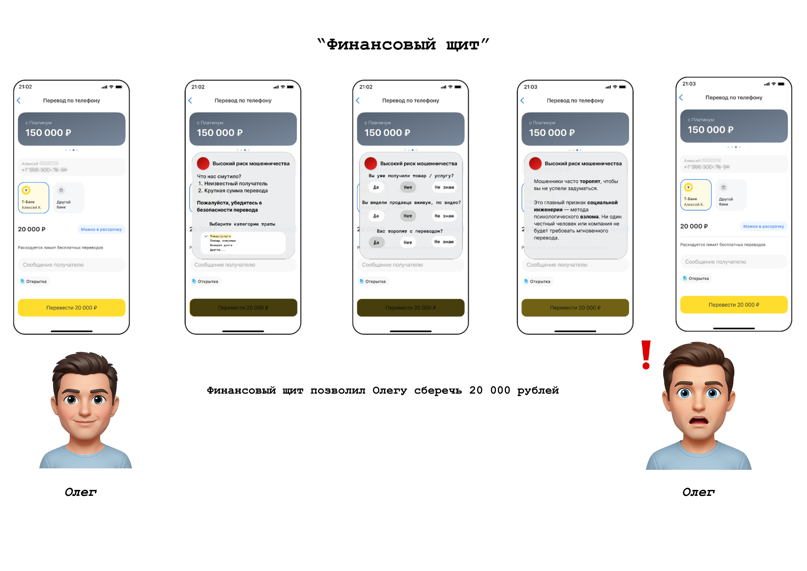

<h1>
  <a href="README.md"></a>
  <a href="README.ru.md"></a>
  Финансовый щит
</h1>

[↩ Прикладные проекты](https://github.com/levg00/levg00/blob/main/portfolio/applied.ru.md)

Концепция функции финансового приложения для защиты от мошеннических и импульсивных операций. **Предложил предупреждения, которые учитывают риск операции и сохраняют окончательное решение за пользователем.**

Кейс в рамках отбора на стажировку в **Т-Банк**. Результат работы — продуктовая концепция, логика вмешательства и **3 визуальных сценария**.

**Продуктовое проектирование · Анализ требований · Пользовательские сценарии · Оценка риска · Метрики**

### 🖼️ [Визуальные сценарии](#-пользовательские-сценарии) · 📄 [Полное решение](materials/solution.pdf)

## 🎯 Задача и решение

**Задача:** помочь пользователю избежать финансовой ошибки, не создавая лишних препятствий для обычных операций.

**Решение:** оценивать контекст операции и менять уровень вмешательства — от отсутствия предупреждения до уточняющих вопросов и временной задержки. Пользователь сохраняет возможность продолжить операцию.

| Риск | Поведение функции |
| :--- | :--- |
| 🟢 Низкий | Операция без вмешательства |
| 🟡 Средний | Предупреждение, пояснение риска и контрольный вопрос |
| 🔴 Высокий | Предупреждение, 2–3 вопроса, примеры мошенничества и временная задержка |

## ⚡ Что сделал и какие навыки применил

- **Анализ требований:** учёл эффективность защиты, ненавязчивость и сохранение контроля за пользователем.
- **Продуктовое проектирование:** предложил три уровня вмешательства и категории данных для оценки риска.
- **Пользовательские сценарии:** проработал мошенническую предоплату, импульсивную инвестицию и обычную покупку с ложным срабатыванием.
- **Продуктовая аналитика:** предложил метрики эффективности защиты и её влияния на пользовательский опыт.

## 🖼️ Пользовательские сценарии

**Пример: подозрительная предоплата за PlayStation 5.** Предупреждение объясняет риск, вопросы помогают оценить ситуацию, а задержка даёт время обдумать решение.

[](materials/scenario-oleg.pdf)

*Иллюстрация концепции. Сумма на макете относится к вымышленному сценарию, а не к измеренному результату внедрения. Нажми на изображение, чтобы открыть PDF.*

- **[Олег — мошенническая предоплата](materials/scenario-oleg.pdf):** PlayStation 5 за 20 000 ₽, новый получатель и требование срочно перевести всю сумму.
- **[Дима — импульсивная инвестиция](materials/scenario-dima.pdf):** покупка резко выросшей акции на последние деньги перед оплатой жилья.
- **[Анна — ложное срабатывание](materials/scenario-anna.pdf):** покупка подарка в аэропорту; пользователь осознанно продолжает операцию после предупреждения.

## 📊 Как оценивать результат

Предложены метрики для проверки функции **после внедрения**:

| Что оцениваем | Метрики |
| :--- | :--- |
| Эффективность защиты | Количество мошеннических транзакций; доля отмен после предупреждения |
| Ненавязчивость | Количество ложных срабатываний; количество пользователей, отключивших функцию |

<br>

## ⚙️ Детали решения

<details>
<summary><b>Параметры оценки риска и логика вмешательства</b></summary>

Функция учитывает контекст операции. В концепции выделены пять категорий параметров:

| Категория | Примеры параметров |
| :--- | :--- |
| Транзакция | Сумма, получатель, назначение, валюта и тип операции |
| Поведение | Время операции, характеристики ввода, устройство и геолокация |
| Инвестиции | Объём покупки, динамика акции, признаки FOMO, потребность в деньгах в ближайшее время |
| Профиль пользователя | Возраст, опыт использования приложения и история ошибок |
| Осознанность решения | Эмоциональное состояние, понимание безопасности операции и финансовая грамотность |

При высоком риске предложены предупреждение, 2–3 уточняющих вопроса, информация об аналогичных случаях мошенничества и временная задержка. Также предложена возможность отменить операцию в течение 5–10 секунд после подтверждения.

Полная блокировка в концепции не предусмотрена: пользователь сохраняет возможность продолжить операцию.

</details>

<details>
<summary><b>Влияние на другие части продукта</b></summary>

- **Онбординг:** демонстрация принципа работы защиты.
- **Настройки:** выбор уровня вмешательства, настройка вопросов и таймера.
- **Поддержка:** гипотеза о снижении числа обращений по спорным операциям.
- **Аналитика:** сбор показателей работы предупреждений и реакции пользователей.

</details>

<details>
<summary><b>Дальнейшая проработка</b></summary>

- [ ] Уточнить источники и доступность данных для оценки риска.
- [ ] Определить правила расчёта риска и выбора предупреждений.
- [ ] Проработать техническую схему задержки и отмены операций.
- [ ] Проверить понятность сценариев и ненавязчивость вмешательства.
- [ ] Подготовить эксперимент для оценки эффективности и ложных срабатываний.

</details>

<br>

> [!NOTE]
> **Статус:** продуктовая концепция с визуальными сценариями. Программная реализация, пользовательское тестирование и результаты внедрения в этих материалах не представлены.

## 📂 Материалы

- [Полное решение кейса](materials/solution.pdf) — принцип работы, параметры оценки, сценарии, влияние на продукт и метрики.
- [Сценарий Олега](materials/scenario-oleg.pdf) · [Сценарий Димы](materials/scenario-dima.pdf) · [Сценарий Анны](materials/scenario-anna.pdf).

<details>
<summary><b>Структура файлов</b></summary>

```text
README.md                    — описание на английском
README.ru.md                 — описание на русском
assets/scenario-oleg.png      — превью сценария для README
materials/solution.pdf        — исходное решение кейса
materials/scenario-oleg.pdf   — визуальный сценарий Олега
materials/scenario-dima.pdf   — визуальный сценарий Димы
materials/scenario-anna.pdf   — визуальный сценарий Анны
```

</details>
